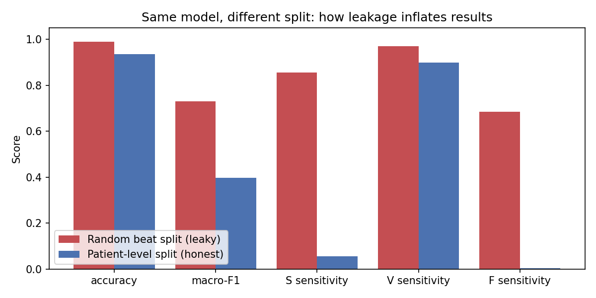
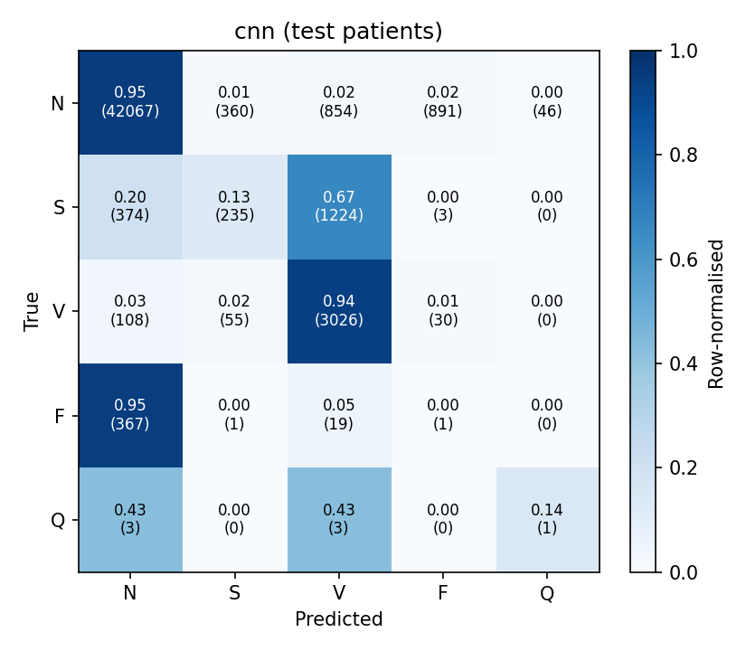

# ECG Arrhythmia Classification (MIT-BIH, patient-level evaluation)

Classifies individual heartbeats from ECG recordings into the 5 AAMI classes using a
1D CNN, evaluated the **honest** way: the patients in the test set are never seen in
training.

| Class | Meaning |
|---|---|
| N | Normal and bundle-branch-block beats |
| S | Supraventricular ectopic (premature atrial etc.) |
| V | Ventricular ectopic (PVCs) |
| F | Fusion of ventricular and normal |
| Q | Unclassifiable |

## Why this project is different: no data leakage

Most MIT-BIH tutorials shuffle beats randomly into train and test. Each patient has
thousands of beats with a very personal waveform, so the same patient ends up on both
sides and the model learns to recognise **patients**, not **arrhythmias**. That is how
you get the "99% accuracy" numbers you see online.

This project uses the standard **inter-patient split** (de Chazal et al., 2004):
22 patients for training (DS1) and 22 *different* patients for testing (DS2).
`src/leakage_demo.py` trains the same model with both splits so you can see the gap.

## Pipeline

1. **Data** (`src/data.py`): download MIT-BIH from PhysioNet, use lead MLII, band-pass
   filter at 0.5–40 Hz, cut a 250-sample window around each annotated R-peak, z-score
   it, and compute RR-interval timing features. Paced records are excluded (AAMI).
2. **Split** (`src/split.py`): DS1 → train (+3 validation patients for early
   stopping), DS2 → test. Includes an assertion that no patient is in two splits.
3. **Baselines** (`src/baseline.py`): logistic regression and a random forest on
   hand-crafted morphology and RR features.
4. **Leakage demo** (`src/leakage_demo.py`): random beat split vs patient split.
5. **1D CNN** (`src/model.py`, `src/train.py`): 4 conv blocks learn the waveform; RR
   features join before the classifier head. Class-weighted loss for imbalance, light
   augmentation, early stopping on validation macro-F1.
6. **Evaluation** (`src/evaluate.py`): per-class sensitivity and PPV (AAMI style),
   macro-F1 and confusion matrices. Accuracy alone is misleading, since about 89% of
   beats are normal.

## Setup (Windows + VS Code)

```bat
git clone https://github.com/meghap-27/ECG-Detect.git
cd ECG-Detect
setup.bat
```
This copies the VS Code settings from `vscode_config/` into `.vscode/` (run/debug
configurations, tasks, test discovery, interpreter), creates `.venv` and installs the
dependencies. Then open this folder in VS Code, press `Ctrl+Shift+P` → **Python: Select Interpreter**
→ pick `.venv`. Install the recommended extensions when VS Code asks.

## Run

Use the **Run and Debug** panel (`Ctrl+Shift+D`): the configurations are numbered in
order. Or use the terminal:

```bat
python -m src.data           :: downloads ~100 MB once, builds data/processed/beats.npz
python -m src.baseline
python -m src.leakage_demo
python -m src.train          :: add --epochs 3 for a quick check
python -m pytest -q          :: smoke tests on synthetic data
```

`Ctrl+Shift+B` runs the whole pipeline. Explore the data in `notebooks/01_eda.ipynb`.
All metrics and plots are saved to `reports/`.

## 3D dashboard

```bat
python -m app.server
```
Open http://127.0.0.1:5000 (or use the **5. Launch 3D dashboard** run configuration).

Heartbeats from a test patient stream onto 3D ECG paper. Each beat is drawn in ink
coloured by the cardiologist's label, and older beats recede into a landscape behind
it. A flag marks every beat where the model disagreed. Click any beat to see its
waveform, the model's confidence per class and the RR interval. **Next disagreement**
jumps straight to the model's mistakes, which is useful for error analysis and demos.
Below the 3D view are the per-class results, the confusion matrix and the leakage
comparison, read live from `reports/`.

It works at every stage of the project:
- before `src.data`: synthetic demo beats (clearly labelled as demo mode)
- before training: cardiologist labels only
- after `src.baseline`: random-forest predictions
- after `src.train`: CNN predictions

Built with Flask and Three.js (bundled in `app/static/vendor`, so no CDN is needed).

## Results (test patients, DS2)

49,668 beats from 22 patients that no model saw during training.
Se = sensitivity (share of real beats caught), PPV = precision.

| Model | Accuracy | Macro-F1 | N Se | S Se | V Se | V PPV |
|---|---|---|---|---|---|---|
| Logistic regression | 73.8% | 0.376 | 75.7% | **38.0%** | 70.0% | 83.1% |
| Random forest | **93.3%** | **0.397** | **98.0%** | 5.6% | 90.2% | **93.7%** |
| 1D CNN | 91.3% | 0.384 | 95.1% | 12.8% | **94.0%** | 59.0% |

### Data leakage, measured

The same random forest, trained twice with only the split changed:

| Split | Accuracy | Macro-F1 | S Se | F Se |
|---|---|---|---|---|
| Random beat split (leaky) | 99.0% | 0.731 | 85.5% | 68.5% |
| Patient-level split (honest) | 93.5% | 0.398 | 5.6% | 0.5% |



### What the results show

- **Leakage makes results look much better than they are.** With a random split,
  supraventricular (S) sensitivity is 85.5%; on unseen patients it falls to 5.6%.
  The "99% accuracy" figures common online come from this kind of split.
- **Ventricular beats generalise well.** The CNN catches 94% of V beats in new
  patients. Its V precision is lower (59%), so it raises more false alarms than the
  random forest.
- **Supraventricular beats are the open problem.** Their shape is close to normal;
  mainly their timing differs. No model detects them reliably across patients.
  Logistic regression catches the most (38%), at very low precision.
- **The CNN does not beat the random forest overall** on macro-F1. With this data
  and split, hand-crafted features remain a strong baseline.
- F and Q are rare in the test patients (388 and 7 beats), so their scores are unstable.



### Next steps

- Richer patient-normalised RR features to target S beats
- Use both ECG leads as input channels
- Focal loss or per-class decision thresholds tuned on the validation patients

## Project structure

```
src/        config, data, split, features, baseline, leakage_demo, model, train, evaluate
app/        3D dashboard (Flask server + Three.js frontend)
tests/      smoke tests (synthetic data, no download)
notebooks/  exploratory data analysis
vscode_config/  VS Code settings (setup.bat copies them into .vscode/)
reports/    generated metrics + confusion matrices
data/       raw + processed data (git-ignored)
models/     saved models (git-ignored)
```

## License

MIT, see [LICENSE](LICENSE). The MIT-BIH data has its own license on PhysioNet and is not included in this repository.

## Data

MIT-BIH Arrhythmia Database, Moody & Mark (2001), PhysioNet.
https://physionet.org/content/mitdb/1.0.0/
